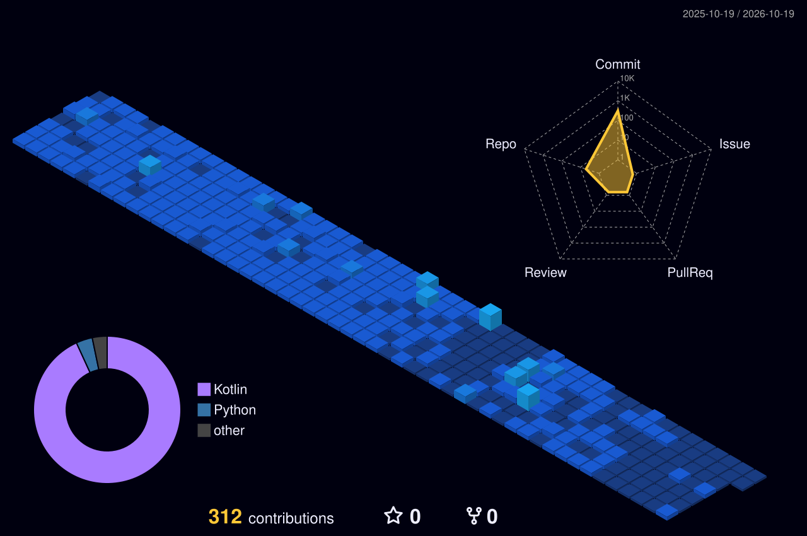

<div align="center">

%20%7C%20Autonomous%20Driving%20%7C%20Reinforcement%20Learning%20%7C%20Edge%20AI&descAlignY=58&descSize=18)

[](https://git.io/typing-svg)

</div>

---

## 활동



---

## 관심 분야

```text
Robotics (VLA)      Autonomous Driving  Reinforcement Learning
Computer Vision     Sim2Real            Edge Inference
Local LLM / VLM     AI Agent            Research Automation
On-Device AI        RAG System          Workflow Automation
```

---

## 기술 스택

### AI / ML / Robotics

<p>
  
  
  
  
  
  
  
  
  
  
  
  
</p>

### Backend / Application

<p>
  
  
  
  
  
</p>

### Frontend

<p>
  
  
  
  
</p>

### Data / Automation / Infra

<p>
  
  
  
  
  
</p>

### Tools

<p>
  
  
</p>

---

## 대표 프로젝트

### Edge Autonomous Driving & VLM QLoRA with CARLA

> CARLA 시뮬레이션 환경에서 자율주행 인지 모델 최적화 프로젝트 & VLM 기반 E2E 자율주행 연구 프로젝트

<p>
  
  
  
  
  
  
  
  
  
  
</p>

* CARLA 기반 RGB / Semantic Camera 데이터 수집
* U-Net 기반 차선 영역 분할
* YOLO 기반 객체 탐지
* ONNX 변환 및 TensorRT 최적화 실험
* FP16 / INT8 기반 엣지 추론 성능 비교

🔗 Repository (Edge AI): [Danpun9/edge-autonomous-driving-carla](https://github.com/Danpun9/edge-autonomous-driving-carla)

* Vision-Language Model(VLM)을 활용한 End-to-End 자율주행 모델 연구
* QLoRA 기법을 통한 파라미터 효율적 미세조정(PEFT) 적용

🔗 Repository (VLM QLoRA): [Danpun9/E2E-QLoRA-Autonomous-Driving-CARLA](https://github.com/Danpun9/E2E-QLoRA-Autonomous-Driving-CARLA)

---

### VLA-ARM: Hierarchical LLM Planner & Vision-Language-Action Robot Manipulation

> Qwen3.5 기반 계층형 작업 계획기(9B)와 시각-언어-행동(4B) 정책을 결합한 폐루프(Closed-loop) 로봇 조작 파이프라인

<p>
  
  
  
  
  
  
  
  
</p>

* **3계층 아키텍처**: 고수준 작업 계획기(Qwen3.5-9B) + 중수준 VLA 정책(Qwen3.5-4B) + 저수준 6-DoF 미분 역기구학(DLS DiffIK) 파이프라인 설계
* **단일 GPU 최적화 (16GB VRAM)**: 언어 디코더 NF4 4-bit 양자화 및 LanguageSpatialSoftmax를 적용하여 VLA VRAM을 8.55 GB에서 3.15 GB로 63% 절감, Planner와 단일 16GB GPU 동시 상주
* **10 Hz 폐루프 제어**: 3개 시점 카메라(Top, Side, Wrist) 및 8D 상태 입력 기반 8-step 액션 청킹(Action Chunking)과 Receding-horizon 실행
* **정량 평가 성과**:
  * 미학습 시드 단일 Pick & Place 성공률 **80.0%** (8/10) 달성
  * 4종 물체 4색 접시 다중 연속 분류(Sorting, 8단계) 물체 파지·안착 성공률 **75.0%** (15/20) 달성
* **초고속 학습 파이프라인**: 백본 특징 디스크 캐싱(1회 사전 추출) 기법 및 멀티프로세스 병렬 HDF5 데모 수집 (DART 노이즈 주입) 구현

🔗 Repository: [Danpun9/VLA-ARM](https://github.com/Danpun9/VLA-ARM)

---

### super-maRlo: Super Mario Bros Reinforcement Learning Agent

> PPO 심층 강화학습과 커스텀 보상 체계(Reward Shaping)를 통한 Super Mario Bros (Stage 1-1) 100% 자율 완주

<p>
  
  
  
  
  
  
  
  
</p>

* **픽셀 기반 PPO 에이전트**: Stable-Baselines3 PPO 및 DeepMind NatureCNN 공유 백본 기반으로 화면 픽셀로부터 7개 이산 행동(SIMPLE_MOVEMENT) 직접 학습
* **시계열 비전 전처리 파이프라인**: 4-Frame Skip, 84×84 흑백 다운샘플링, 4-Frame Stacking을 통한 동적 물리 정보(속도, 가속도, 적 이동) 인지
* **피라미드 고착(Freezing) 극복 및 보상 설계**: 후반부 거대 계단(X≥2800) 정체 문제를 해결하기 위해 거리 비례 가중치, 정체 페널티, 구간별 마일스톤 보상 및 깃대 터치 보너스를 설계하여 **최종 X=3161 (100% 클리어 🏁)** 달성
* **초고속 병렬 학습 환경**: `SubprocVecEnv` 8개 병렬 프로세스로 RTX 4080 SUPER 기준 **~630 FPS** 달성 (200만 스텝 학습에 약 50분 소요, Explained Variance 0.95 달성)
* **실시간 웹 스트리밍 플레이어**: Flask 기반 저지연 MJPEG 웹 스트리밍(`web_play.py`) 및 OSD 오버레이(현재 좌표, 누적 보상, 선택 행동) 시각화 제공

🔗 Repository: [Danpun9/super-maRlo](https://github.com/Danpun9/super-maRlo)

---

### Bask:EAT

> AI 레시피 추천, 영상 기반 레시피 추출, 식재료 인식, 쇼핑 연계를 포함한 푸드테크 AI 서비스

<p>
  
  
  
  
  
  
</p>

* Gemini API와 LangChain을 활용한 AI 레시피 어시스턴트
* YouTube 영상 기반 레시피 정보 추출
* 식재료 이미지 인식 및 상품 검색
* Spring Boot, FastAPI, Next.js 기반 서비스 구조
* 팀 프로젝트 리딩 및 서비스 아키텍처 설계 경험

🔗 Organization: [Bask-EAT](https://github.com/Bask-EAT)

---

### PaperC0re

> arXiv 논문 수집, AI 요약, 키워드 태깅, 뉴스레터 발송을 자동화하는 연구 정보 수집 시스템

<p>
  
  
  
  
  
  
</p>

* 키워드 기반 arXiv 논문 수집
* LLM 기반 논문 요약 및 주요 용어 분석
* 논문 중복 제거 및 키워드 태깅
* n8n 기반 자동화 워크플로 설계
* 연구 주제별 뉴스레터 발송 구조

🔗 Organization: [PaperC0re](https://github.com/PaperC0re)

---

## 연락처

<p>
  <a href="mailto:joonseekpark@gmail.com">
    
  </a>
  <a href="https://github.com/Danpun9">
    
  </a>
</p>


